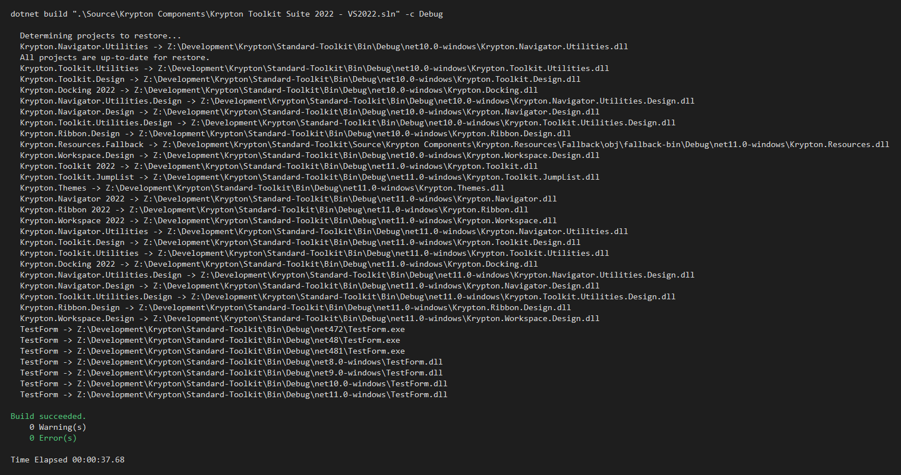

# Feature: Caption text box and search box (#4550)

## Summary

Caption hosting lives on `KryptonCaptionForm` so ordinary `KryptonForm` designers stay unchanged. Each control has its own left, centre, or right edge. Drop a `KryptonFormCaptionItems` component for a designer list, or assign `CaptionTextBox` for a single text box (including a `KryptonSearchBox`).

## Related issues

- Closes #4550

## Type of change

- [x] Feature / enhancement (`Implemented`)

## Changes

- New `KryptonCaptionForm` derived from `KryptonForm` with caption hosting (owned windows, per-control edges, centre title clearance).
- `KryptonForm` keeps empty protected chrome hooks (`PrepareCaptionChromeSlots`, `SyncCaptionChromeHosts`, and related members) for the derived override.
- Toolbox component `KryptonFormCaptionItems` with `Items` of `KryptonFormCaptionItem` (control + edge); `OwnerForm` is a `KryptonCaptionForm`.
- Designer keeps `CaptionTextBox` / `CaptionTextBoxEdge` on `KryptonCaptionForm`. Multi-control methods and `CaptionControl` are advanced / not browsable.

## Affected packages & target frameworks

- Packages: `Krypton.Toolkit`
- TFMs verified: Debug suite build (VS2022 solution)

## Validation

- TestForm demo: `CaptionTextBoxDemo` (inherits `KryptonCaptionForm`, uses `KryptonFormCaptionItems`).
- Standard-Toolkit-Demos: `KryptonForm Examples` on `alpha-4550-caption-textbox`.
- Manual steps:
  1. Open `Caption TextBoxDemo` from StartScreen.
  2. Confirm left button, centre combo, and right search/text boxes sit in the caption and remain interactive.
- Build: `dotnet build ".\Source\Krypton Components\Krypton Toolkit Suite 2022 - VS2022.sln" -c Debug`



## Screenshots / GIFs


## Changelog

```markdown
- Implemented [#4550](https://github.com/Krypton-Suite/Standard-Toolkit/issues/4550), `KryptonTextBox` & `KryptonSearchBox` in form titlebar
   - Use `KryptonCaptionForm` when the caption hosts controls. Ordinary `KryptonForm` keeps the previous designer surface.
   - Each control has its own left, centre, or right edge. Drop a `KryptonFormCaptionItems` component for several items, or assign `CaptionTextBox` for a single text box (including a `KryptonSearchBox`).
```

## Breaking changes & migration

None for existing `KryptonForm` consumers. Caption hosting requires changing the form base type to `KryptonCaptionForm`.

## Developer documentation

- `Documents/Development/KryptonFormCaptionTextBox.md`
